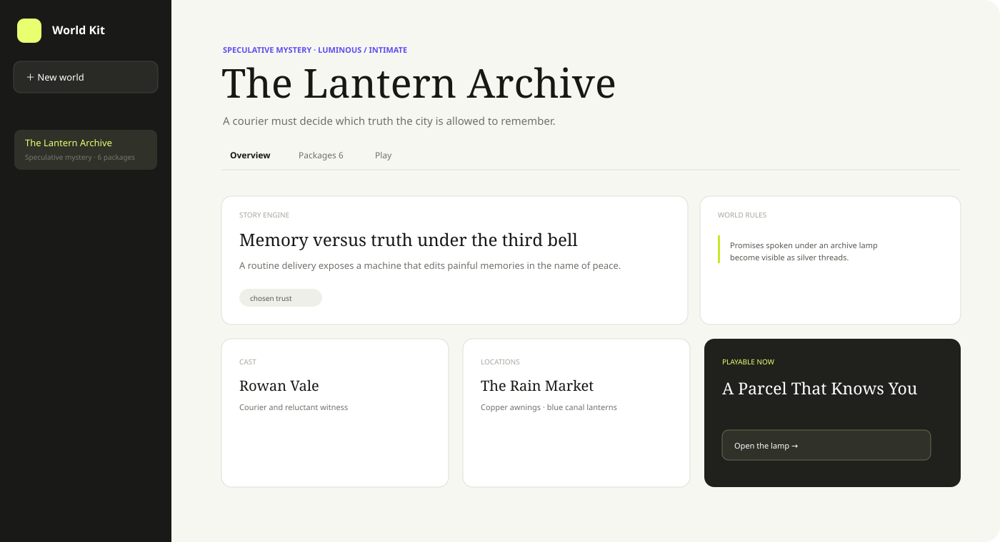

# Agent World Kit

Open-source software for agents that create and run interactive worlds.

Give it one seed. It produces a frozen story canon, characters, connected
locations, narrative beats, continuity rules, media prompts, and six portable
creative packages:

- narrative
- game world
- storyboard
- film treatment
- consistent photoshoot
- interactive visual novel

The included studio lets people inspect the work, play branching sessions,
track state, attach generated media, audit continuity, and export the complete
world as JSON. The engine is model-agnostic. It includes a keyless demo adapter,
an OpenAI-compatible adapter, a public TypeScript interface for custom model
layers, and an elizaOS plugin.



## Quick start

Requires Node.js 20 or newer.

```bash
git clone https://github.com/chadetsell/agent-world-kit.git
cd agent-world-kit
npm install
npm run demo
npm run dev
```

Open [http://127.0.0.1:4317](http://127.0.0.1:4317). The demo adapter works
without network access or API keys and creates a complete example world.

To generate original worlds with any OpenAI-compatible chat-completions API:

```bash
cp .env.example .env
```

```dotenv
WORLDKIT_MODEL_PROVIDER=openai-compatible
WORLDKIT_API_KEY=your-key
WORLDKIT_BASE_URL=https://api.openai.com/v1
WORLDKIT_MODEL=gpt-4.1-mini
```

The base URL can point at OpenAI, Ollama-compatible gateways, vLLM, LM Studio,
NVIDIA NIM, or another service that implements `/chat/completions` and JSON
object responses.

## What gets created

Every world uses `agent-world-kit/world-project@1`. The canon is the source of
truth; every format is an adaptation of that canon rather than an unrelated
generation.

```text
seed brief
  → frozen canon (cast, places, rules, causal story, continuity)
    → narrative / game world / storyboard / treatment / photoshoot / visual novel
      → vendor-neutral media prompt bank
        → attached images, video, audio, music, or 3D assets
          → persistent interactive sessions and choices
```

Each format contains renderable creative blocks and an asset plan. Asset briefs
carry canon character/location ids and explicit continuity anchors, so a media
agent can generate elsewhere and bind the result back to the right scene or
shot without losing lineage.

## CLI

```bash
worldkit serve --port 4317 --data .agent-worlds
worldkit create --brief "A lighthouse receives messages from tomorrow" --formats all
worldkit create --brief "A quiet Mars mystery" --formats narrative,storyboard,visual_novel
worldkit demo
worldkit list
worldkit doctor
```

When developing from a clone, replace `worldkit` with `npm run dev --` or run
`node dist/cli.js` after `npm run build`.

## Use it as a library

```ts
import {
  FileWorldStore,
  OpenAICompatibleAdapter,
  WorldEngine,
} from "agent-world-kit";

const engine = new WorldEngine({
  store: new FileWorldStore(".agent-worlds"),
  model: new OpenAICompatibleAdapter({
    apiKey: process.env.MODEL_API_KEY!,
    baseUrl: process.env.MODEL_BASE_URL,
    model: process.env.MODEL_NAME,
  }),
});

const world = await engine.createWorld({
  brief: "A desert town bargains with its own future shadow.",
  artifactTypes: ["game_world", "storyboard", "visual_novel"],
});

const session = await engine.startSession(world.id);
const next = await engine.choose(world.id, session.id, session.scenes[0].choices[0].id);
```

Implement the small `ModelAdapter` interface to use an agent runtime's native
model selection instead of a chat-completions endpoint. See
[custom-model-adapter.ts](examples/custom-model-adapter.ts).

## elizaOS

The integration under [`integrations/elizaos`](integrations/elizaos) targets
`@elizaos/core` 1.7.x and contributes four actions plus a context provider:

```bash
cd integrations/elizaos
npm install
npm run build
```

```ts
import agentWorldKitPlugin from "@agent-world-kit/plugin-elizaos";

export const project = {
  agents: [{ character, plugins: [agentWorldKitPlugin] }],
};
```

Set `WORLDKIT_URL=http://127.0.0.1:4317` in the elizaOS project. The agent can
then create a complete world, list the library, enter a world, and advance
choices conversationally. The kit remains a separate service so elizaOS can
use its own memory/model stack while any other agent uses the same stable API.

## HTTP API

The studio uses the same public endpoints as agents:

| Method | Endpoint | Purpose |
| --- | --- | --- |
| `GET` | `/api/health` | Readiness and active adapter |
| `GET` | `/api/capabilities` | Machine-readable action manifest |
| `GET/POST` | `/api/worlds` | List or create complete worlds |
| `GET` | `/api/worlds/:id` | Canon, packages, assets, sessions, audits |
| `POST` | `/api/worlds/:id/artifacts` | Generate/replace one format |
| `POST` | `/api/worlds/:id/audit` | Audit every package against canon |
| `POST` | `/api/worlds/:id/sessions` | Start a playthrough |
| `POST` | `/api/worlds/:id/sessions/:sessionId/choose` | Advance a choice |
| `POST` | `/api/worlds/:id/assets` | Bind external/generated media |
| `GET` | `/api/worlds/:id/export` | Download portable world JSON |

OpenAPI discovery is available at `/api/openapi.json`. More examples are in
[docs/API.md](docs/API.md) and [docs/AGENT_INTEGRATION.md](docs/AGENT_INTEGRATION.md).

## Design principles

- Canon first. Identity, wardrobe, props, geography, chronology, and knowledge
  are locked once and reused everywhere.
- Blocks are the universal unit. Agents produce them and every surface can
  render them.
- Providers stay at the boundary. The engine owns creative workflow, not a
  specific vendor.
- Portable by default. Worlds are ordinary versioned JSON files.
- Human-readable traces. Prompts, asset briefs, choices, and continuity issues
  remain inspectable rather than disappearing into opaque jobs.
- Local first. The server binds to `127.0.0.1` and the default adapter makes no
  network requests.

## Development

```bash
npm install
npm run check
npm run dev
```

The package has no runtime dependencies. TypeScript, `tsx`, and Node types are
development-only. See [CONTRIBUTING.md](CONTRIBUTING.md) before opening a PR.

## Release status

`0.1.0` is the first publishable release: complete world creation, all six
packages, local persistence, continuity audit, interactive play, media binding,
studio UI, CLI/API/library entry points, and elizaOS integration are working.

The next useful additions are streaming job progress, optional authenticated
remote hosting, more media-provider adapters, and import/export projections for
specific game engines. Those are extensions of the current contracts, not
requirements for using this release.

## License

[MIT](LICENSE)
